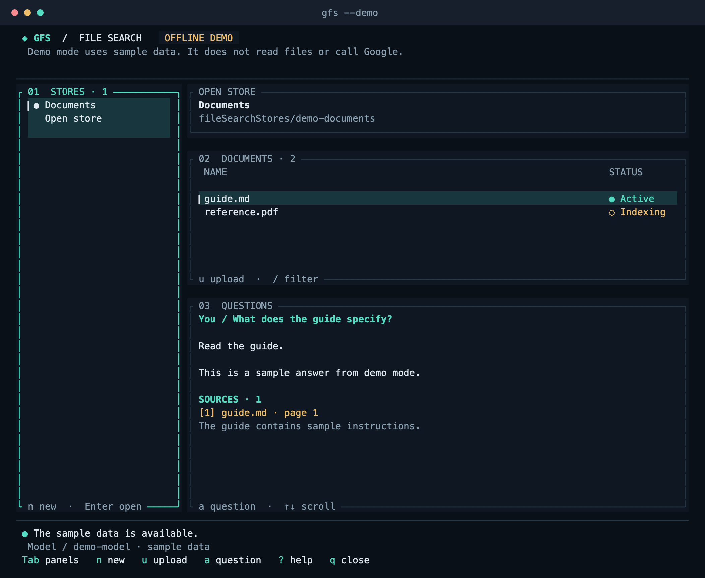

# Gemini File Search

Use `gfs` to manage documents in Gemini File Search.
A store is a collection of indexed documents at Google.
Enter questions about your documents and read the source citations.
Use the terminal interface or command-line commands.
The package also includes an MCP server.

## Install

Install Rust 1.88 or a subsequent version.

```sh
git clone https://github.com/garricm/gemini-file-search.git
cd gemini-file-search
cargo install --path . --bin gfs --locked
```

A Homebrew package is not available at this time.

## Open the demo

```sh
gfs --demo
```

Demo mode uses sample data.
It does not require an API key or a network connection.
It does not read local files.
The app removes the sample changes when you close it.

Use a terminal with at least 64 columns and 20 rows.
For more space, use 100 columns and 32 rows.



## Set the environment variables

Set these variables in the terminal that starts `gfs`:

| Variable | Value |
| --- | --- |
| `GEMINI_FILE_SEARCH_API_KEY` | An API key for the Gemini Developer API. |
| `GEMINI_UPLOAD_ROOT` | The full path to a directory of approved files. |
| `GEMINI_FILE_SEARCH_MODEL` | The query model. The default is `gemini-3.8-flash`. |

Store your API key in a secret manager or an environment variable.
Do not put the key in a command argument or a source file.
The app does not read `.env` files.

Set the key and upload directory for all API commands.
The selected model must support Gemini File Search.
Use `--model` to select a different model.

Start the terminal interface:

```sh
gfs
```

## Use the terminal interface

Select a store in the left panel.
Press `Enter` to open the store.
The filled circle identifies the open store.
The app uses this store for file uploads and questions.

| Key | Action |
| --- | --- |
| `Tab` / `Shift-Tab` | Select a panel. |
| Arrow keys / `j` / `k` | Select an item or scroll the answer. |
| `Enter` | Open the selected store or submit the input. |
| `n` | Create a store. |
| `u` | Upload a file. |
| `a` | Enter a question. |
| `/` | Filter the loaded document names. |
| `Esc` | Close the dialog or remove the filter. |
| `r` | Reload the selected list. |
| `m` | Load the next page of the selected list. |
| `d` | Delete the selected store or document. |
| `PgUp` / `PgDn` / `Home` | Scroll the answer. |
| `Ctrl-U` | Remove all text from the input field. |
| `?` | Show the key list. |
| `q` / `Ctrl-C` | Close the app. |

Type `delete` to delete the selected item.
Store deletion removes all documents in the store.

You can select panels and scroll answers during an API request.
You must wait for that request to finish before you send a new request.
The app keeps only the last question and answer in memory.
The app does not use previous questions.

## Use commands

Use the resource names from the API response.
Do not change these names.
Replace the sample resource names in these commands.

```sh
gfs stores create --name "Documents"
gfs stores list --json
gfs upload guide.pdf --store fileSearchStores/your-store --wait
gfs documents list --store fileSearchStores/your-store
gfs ask --store fileSearchStores/your-store "What does the guide specify?"
gfs documents delete fileSearchStores/your-store/documents/your-document
gfs stores delete fileSearchStores/your-store
```

Use `--help` with a command to see its options.
Use `--json` for JSON output.
The app writes runtime errors to stderr.
To delete an item without an interactive terminal, use `--yes`.

Lists return one page at a time.
If a response includes `nextPageToken`, use `--page-token` to load the next page.

### File limits

- Permitted file types: `.md`, `.txt`, and `.pdf`.
- Maximum file size: 10 MiB.
- Empty files are not permitted.
- All files must stay in `GEMINI_UPLOAD_ROOT`, including symbolic-link targets.

Uploads and questions send data to Google.
API charges can apply.

### Indexing

Google indexes a file after the upload.
An operation ID identifies this process.
Use `--wait` to wait for the result.
The default time limit is 300 seconds.
Use `--timeout` to set a limit from 1 to 3600 seconds.

To continue a wait, use the saved operation ID:

```sh
gfs operation fileSearchStores/your-store/upload/operations/your-operation --wait
```

If you close the app, Google continues the operation.
The app does not send failed write requests again.
Before you upload a file again, examine the document list for an existing copy.

| Exit code | Meaning |
| --- | --- |
| `0` | The request completed. Without `--wait`, indexing can continue. |
| `1` | A configuration error, API error, or indexing failure occurred. |
| `2` | The wait limit expired, or a command argument is incorrect. |

## Connect an MCP client

Build the MCP server:

```sh
cargo build --release --locked --bin gemini-file-search-mcp
```

Set the executable path and environment variables in your MCP client.
Use your client's secret manager for the API key.

```json
{
  "mcpServers": {
    "gemini-file-search": {
      "command": "/absolute/path/to/gemini-file-search-mcp",
      "env": {
        "GEMINI_FILE_SEARCH_API_KEY": "YOUR_API_KEY",
        "GEMINI_UPLOAD_ROOT": "/absolute/path/to/approved-files"
      }
    }
  }
}
```

| Tool | Function |
| --- | --- |
| `gemini_create_store` | Create a store. |
| `gemini_list_stores` | List stores. |
| `gemini_upload_file` | Upload and index a file. |
| `gemini_get_operation` | Read the operation status. |

The MCP server uses stdio transport.
Use the CLI to enter questions or delete documents.

## Development

Do these checks before you submit a change:

```sh
cargo fmt --check
cargo clippy --all-targets --locked -- -D warnings
cargo test --locked
cargo build --locked
python3 tests/stdio_smoke.py
python3 tests/tui_smoke.py
python3 -m unittest discover -s tests -p 'test_homebrew_setup.py'
```

The tests use local HTTP servers and sample data.
They do not call Google.
Test live uploads and queries before production use.

Use ASD-STE100 for new interface text and documentation.

To examine the release files, use dist 0.33.1 with this command:

```sh
python3 scripts/configure_homebrew.py \
  --repository garricm/gemini-file-search \
  --tap garricm/homebrew-tap \
  --check
```

## License

This software uses the [MIT license](LICENSE).
